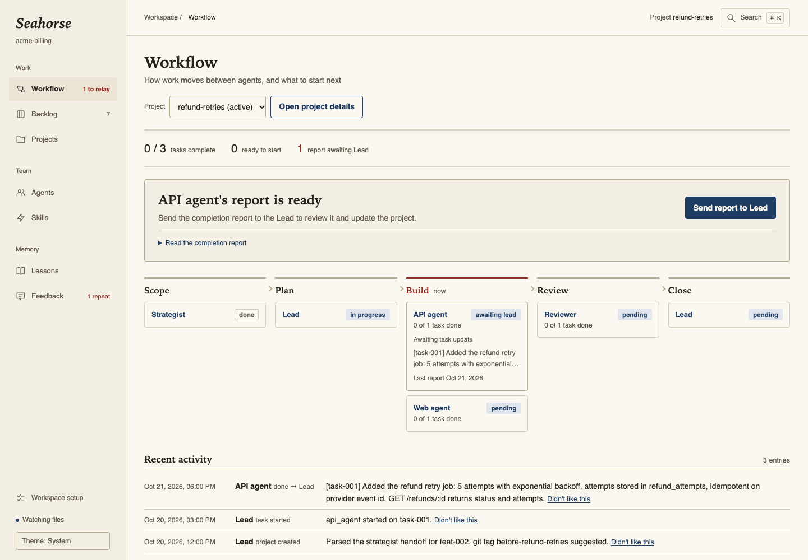
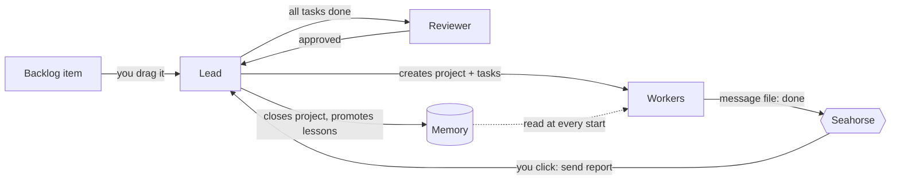
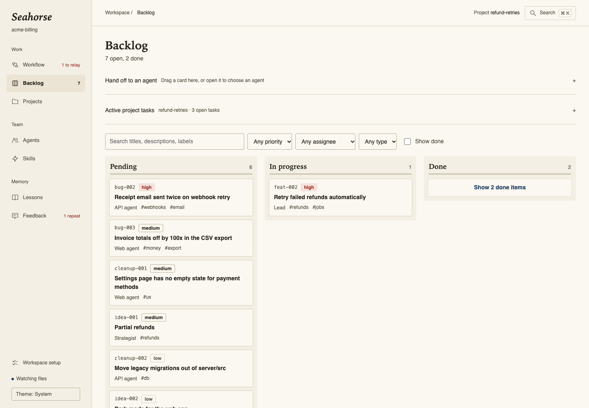
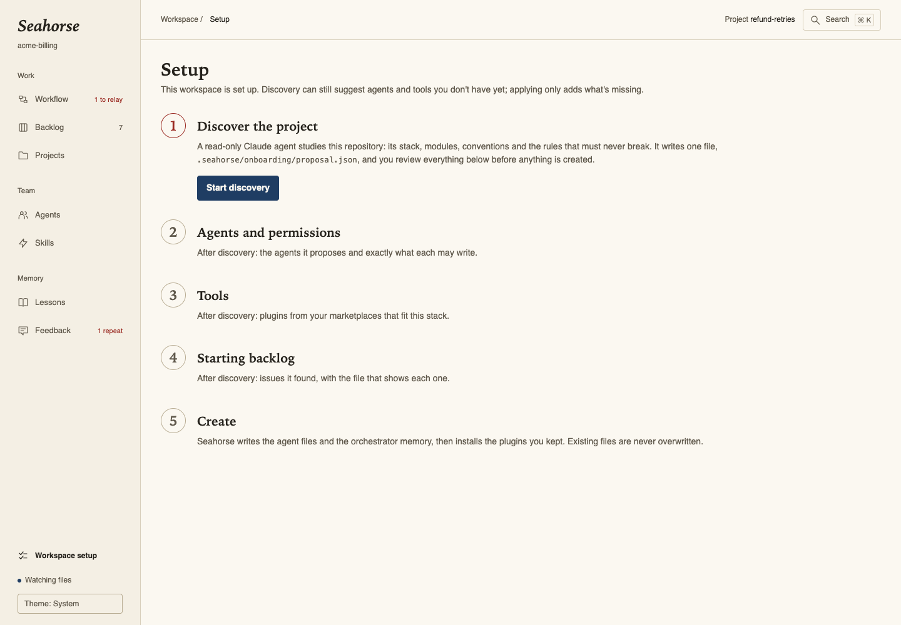
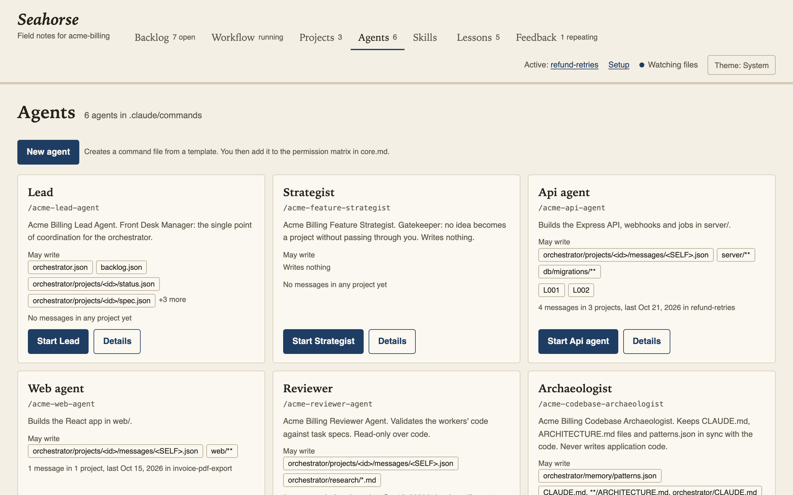
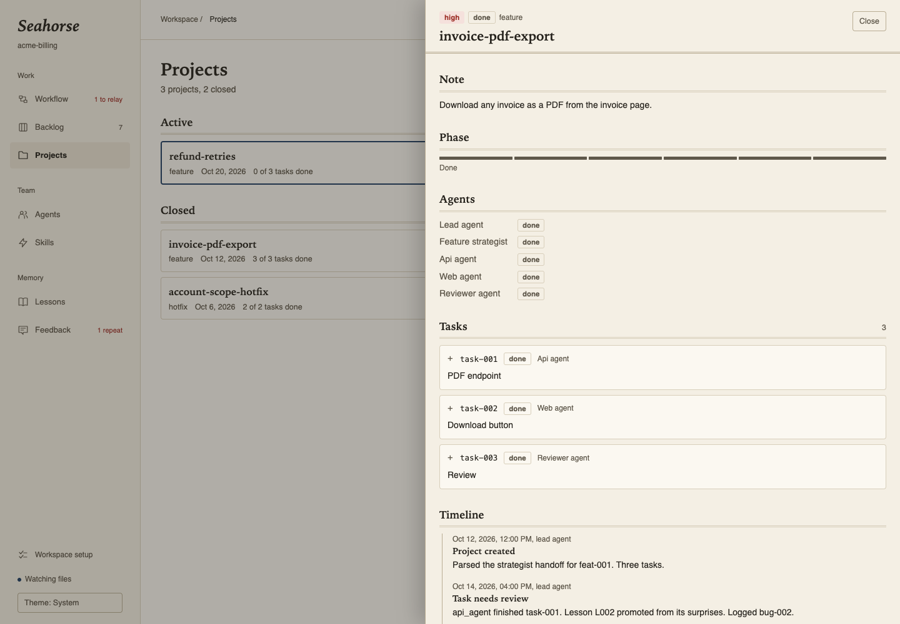
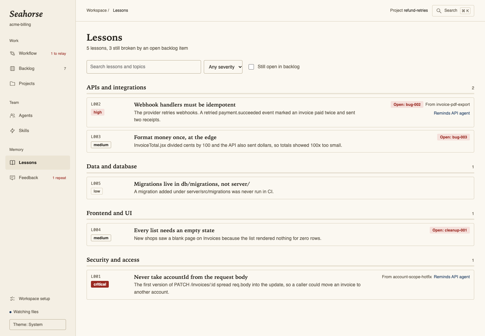
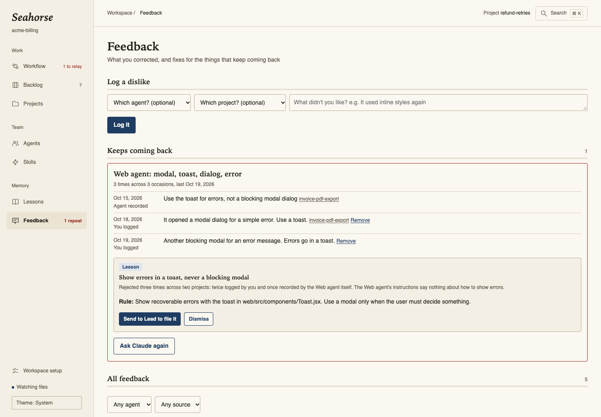
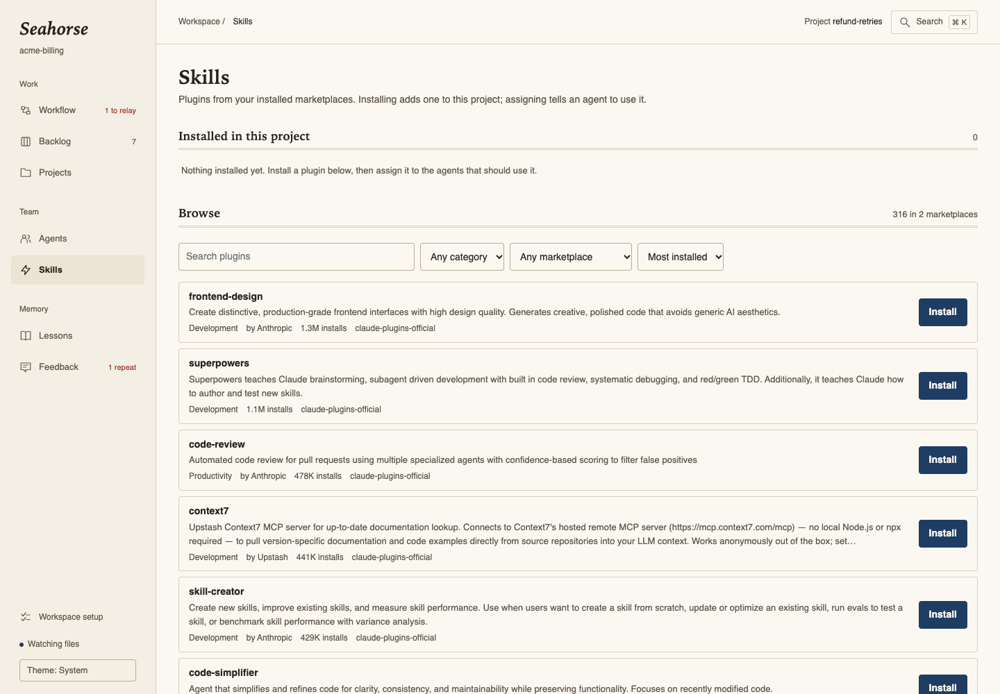
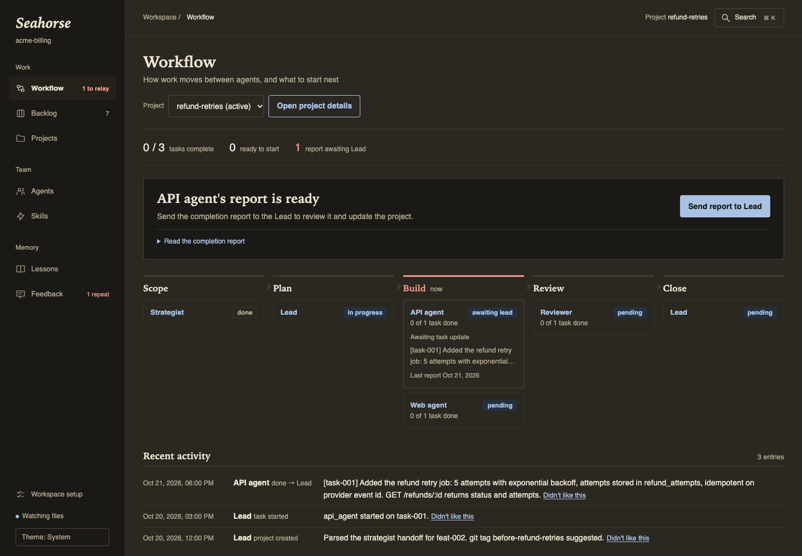

<div align="center">

# Seahorse

**Run a team of Claude Code agents from one board, and let it remember what went wrong.**

[](LICENSE)
[](https://nodejs.org)
[](package.json)



</div>

Seahorse turns your repository into a small team of [Claude Code](https://docs.claude.com/en/docs/claude-code) agents (a lead, a strategist, one worker per area of your code, a reviewer and a docs keeper), each allowed to write only its own files. It then gives you one local page to run that team: a backlog you drag onto agents, a workflow view that says who to start next, the lessons the team has learned, plugins, and a memory of what you keep correcting.

The name comes from the *hippocampus*, Greek for seahorse: the part of the brain that turns short-lived experience into lasting memory. Chat with an agent is forgotten. What it writes to files is kept, shown and used to make the next run better.

**Contents:** [Quick start](#quick-start) · [Where things live](#where-things-live) · [How it works](#how-it-works) · [Tour](#tour) · [Configuration](#configuration) · [Safety](#safety-and-privacy) · [FAQ](#faq) · [Development](#development)

## Quick start

**Requirements:** Node 20+ and the `claude` command from Claude Code on your `PATH`. macOS opens agents in a new Terminal window with one click; on Linux and Windows, Seahorse shows the command to copy instead.

```bash
cd ~/code/your-app
npx github:mostafahussien19/seahorse
```

Open **http://localhost:4600**. A repository without an agent team opens on **Setup**:

1. **Discover.** Seahorse starts `/seahorse-onboard`, a read-only Claude agent that studies your repo and writes a proposal: stack, modules, conventions, commands, the rules that must never break, and issues it can point to in the code.
2. **Review** the proposed worker agents and exactly which paths each may write. Untick or edit anything.
3. **Pick tools** from your Claude Code plugin marketplaces. Only plugins that exist there are offered.
4. **Create.** Seahorse writes the agents and the team's memory into your repo, then installs the plugins you kept.

Then open the Backlog, drag an item onto the Lead, and the team starts working.

### Try it without your own repo

The repo ships a fictional project that's already set up, so you can see everything before running Setup:

```bash
git clone https://github.com/mostafahussien19/seahorse.git
cd seahorse
node server.mjs examples/acme-billing
```

## Where things live

Seahorse itself is just a server and a page. **The agents and their memory are created inside your project** when you run Setup, so you won't find them in this repo except in the example.

<table>
<tr><th>This repo (the tool)</th><th>Your project, after Setup</th></tr>
<tr><td valign="top">

```text
seahorse/
├── server.mjs       the local server
├── public/          the board (one HTML page)
├── lib/             generators and feedback logic
├── kit/             starter files copied into
│   ├── agents/        your project by Setup
│   ├── commands/
│   └── orchestrator/
└── examples/
    └── acme-billing/  a finished example
```

</td><td valign="top">

```text
your-app/
├── .claude/commands/        the agents
│   ├── acme-lead-agent.md
│   ├── acme-api-agent.md
│   └── …
├── orchestrator.json        project list
├── backlog.json             bugs, ideas, tasks
├── orchestrator/
│   ├── memory/              the team's memory
│   │   ├── core.md            rules + permissions
│   │   ├── domain_context.md  modules, conventions
│   │   ├── lessons.json       mistakes learned
│   │   └── patterns.json      code style
│   ├── projects/<id>/       one folder per project
│   ├── research/            review reports
│   ├── schemas/  templates/
└── .seahorse/               Seahorse's own state
```

</td></tr>
</table>

| File | Written by | What it holds |
|---|---|---|
| `.claude/commands/*.md` | Setup | One file per agent, run as a slash command such as `/acme-lead-agent` |
| `orchestrator/memory/core.md` | Setup, then **only you** | The rules every agent follows and the permission matrix |
| `orchestrator/memory/domain_context.md` | Setup, then you | What discovery learned: modules, conventions, constraints, commands |
| `orchestrator/memory/lessons.json` | The lead | Mistakes worth never repeating, with the fix |
| `orchestrator/memory/patterns.json` | The archaeologist | Code style rules |
| `orchestrator.json`, `backlog.json` | The lead | Every project and the backlog |
| `orchestrator/projects/<id>/` | The lead and the agents | Status, spec, tasks, an event log, and one message file per agent |
| `orchestrator/research/review-<id>.md` | The reviewer | Review reports |
| `.seahorse/` | Seahorse | Onboarding proposal, feedback you logged, reminders, skill assignments |

Setup never overwrites a file that exists, and it leaves `orchestrator/projects/` empty: the lead creates a folder when it starts a project.

## How it works

One rule holds the team together: **if it isn't in a JSON file, it didn't happen.** Agents never talk to each other. Each appends to its own message file, and the lead reads those files and decides what happens next. Seahorse watches the files and shows you the next step.



| Agent | Job | May write |
|---|---|---|
| Lead | Turns ideas and bugs into projects and tasks, routes work, promotes lessons | Project state, backlog, `lessons.json` |
| Strategist | Scopes a feature idea into a handoff block | Nothing |
| Workers | Build their tasks, one agent per area (for example `api_agent`, `web_agent`) | Their code paths and their own message file |
| Reviewer | Checks the work against the task and the project's rules | Review reports and its message file |
| Archaeologist | Keeps `CLAUDE.md` and `ARCHITECTURE.md` files true to the code | Docs and `patterns.json` |

A project moves through `task_defined → research → spec_ready → implementation → review → done`. Only the lead changes the phase, and nothing closes without an approved review.

## Tour

*Screenshots use the fictional [Acme Billing example](examples/acme-billing).*

### Backlog

Drag an item onto the Lead to turn it into a project, or onto the Strategist to scope it. Tasks in the active project go to the agent they're assigned to. Each drop opens that agent in a new terminal with the right prompt.



### Setup

Discovery proposes the team. You decide what each agent may write before anything is created.



### Agents and projects

Every agent with what it may write, its skills, pinned lessons and recent work. Every project with its tasks, timeline, agent messages and review report.





### Lessons

Mistakes the lead recorded, grouped by topic, each linked to the project it came from and to open backlog items that still break it. **Enforce** sends the lead to search the code for the mistake, **Retire** has it confirm the mistake can't happen any more, and **Remind** pins the lesson into an agent's prompt.



### Feedback

Seahorse notices what you keep correcting. Agents record your corrections, you can log a dislike yourself, and reviewer rejections count against the agent whose files they name. When the same complaint comes back, **Ask Claude for a fix** proposes a lesson, a plugin, or a new agent. Nothing changes until you accept one.



### Skills

Every plugin in your Claude Code marketplaces. Install one into the project, then tick which agents should use its skills.



Light and dark themes follow your system, with a switch in the header.



## Configuration

| Setting | Default | What it does |
|---|---|---|
| First argument | current folder | The project to open: `npx github:mostafahussien19/seahorse ~/code/app` |
| `PORT` | `4600` | The port for the board |
| `BOARD_NO_TERMINAL=1` | off | Show agent commands to copy instead of opening Terminal |
| `WORKSPACE` | | Same as the first argument |

## Safety and privacy

- **Local only.** The board listens on `127.0.0.1`. Seahorse sends nothing anywhere; the only network use comes from the `claude` CLI when you install a plugin.
- **No surprise actions.** Every request that changes anything needs a token embedded in the page at startup and a `localhost` address, so other websites you have open can't trigger it.
- **No shell injection.** Agent prompts are built from fixed text plus ids that must match `[a-z0-9-]` and exist in your files. Nothing you type in the browser reaches a shell.
- **The agents own their files.** Seahorse doesn't edit `orchestrator.json`, `backlog.json`, project files or `lessons.json`; it only creates them during Setup. It changes existing agent files and the message schema only when you click **Add the feedback rule**.
- **You stay in the loop.** Seahorse never starts an agent on its own. Every handoff is a click.

## FAQ

**Does Seahorse cost anything or need an API key?**
No. Seahorse doesn't call any AI service. Agents run in your own Claude Code session, under your own account.

**I already have Claude Code agents. Can I use Seahorse?**
Yes. Any `.claude/commands/*.md` file with an `# IDENTITY: <role>` line counts as an agent. Run Setup on your repo: it adds only what's missing and never overwrites files.

**Should I commit `.seahorse/`?**
Commit it if your team should share logged feedback, lesson reminders and skill assignments. Add it to `.gitignore` if they're personal.

**Does it work on Linux and Windows?**
Yes. Everything works except one-click launching, which opens macOS Terminal. Elsewhere Seahorse shows the command with a copy button.

## Development

```bash
npm test                              # node --test, no dependencies
node server.mjs examples/acme-billing # run against the example
```

| Path | What lives there |
|---|---|
| `server.mjs` | HTTP server, file watching, agent launching, plugin and onboarding endpoints |
| `lib/kit.mjs` | Agent templates, `core.md` and `domain_context.md` generators, the permission matrix parser |
| `lib/feedback.mjs` | Collecting feedback and finding repeats |
| `kit/` | The starter files Setup copies into a project |
| `public/index.html` | The whole interface |
| `docs/DESIGN.md` | The visual direction |

## License

[MIT](LICENSE)
