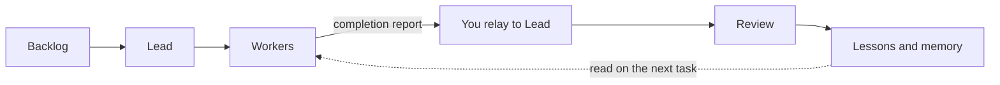
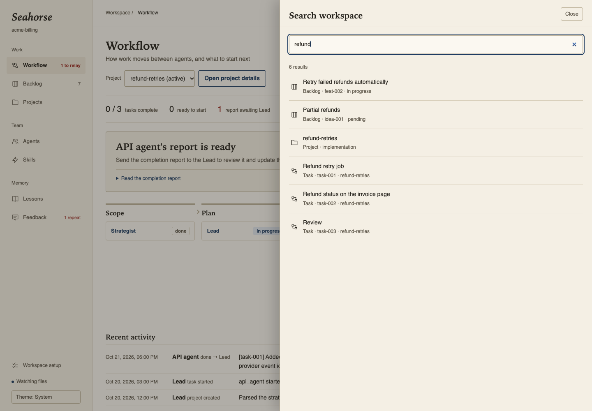
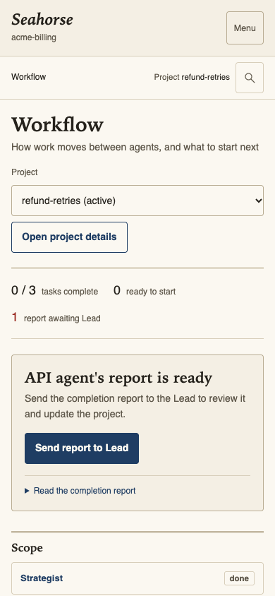

<div align="center">

# Seahorse

**A local workflow board and persistent memory for Claude Code teams.**

[](LICENSE)
[](https://nodejs.org)
[](package.json)


</div>

Coordinate [Claude Code](https://docs.claude.com/en/docs/claude-code) agents, review their handoffs, and turn repeated corrections into lessons for future tasks. Seahorse runs locally, uses files you can inspect and commit, and has no npm dependencies.

- **Know what to do next.** Workflow brings the next handoff, task totals, and recent activity together.
- **Keep corrections useful.** Feedback groups recurring complaints; accepted proposals can become lessons, plugins, or new agents.
- **Find the context.** Search backlog items, project tasks, projects, lessons, and agents with Command/Control K.

The name comes from the *hippocampus*, Greek for seahorse: the part of the brain that turns short-lived experience into lasting memory.

**Contents:** [Quick start](#quick-start) · [How it works](#how-it-works) · [Tour](#tour) · [Keyboard shortcuts](#keyboard-shortcuts) · [Configuration](#configuration) · [Safety and limitations](#safety-and-limitations) · [FAQ](#faq) · [Development](#development)

## Quick start

**Requirements:** Node 20+ and the `claude` command from Claude Code on your `PATH`. macOS opens agents in a new Terminal window with one click; on Linux and Windows, Seahorse shows the command to copy instead.

```bash
cd ~/code/your-app
npx github:mostafahussien19/seahorse
```

Open **http://localhost:4600**. A repository without an agent team opens on **Setup**:

1. **Discover.** Seahorse starts `/seahorse-onboard`, a Claude agent instructed to inspect your code without changing it and write an onboarding proposal: stack, modules, conventions, commands, the rules that must never break, and issues it can point to in the code.
2. **Review** the proposed worker agents and exactly which paths each may write. Untick or edit anything.
3. **Pick tools** from your Claude Code plugin marketplaces. Only plugins that exist there are offered.
4. **Create.** Seahorse writes the agents and the team's memory into your repo, then installs the plugins you kept.

Configured workspaces open on **Workflow**. To start new work, open **Backlog** and send an item to the Lead, using the buttons in its details or dragging it onto an agent. Each handoff is an action you launch yourself.

### Try it without your own repo

The fictional Acme Billing workspace is already set up. You can browse its workflow, projects, lessons, and feedback without starting an agent:

```bash
git clone https://github.com/mostafahussien19/seahorse.git
cd seahorse
node server.mjs examples/acme-billing
```

Open **http://localhost:4600**. The API agent has reported completion, so Workflow offers to send its report to the Lead. Running agents from the example still uses your Claude Code account.

## How it works

Agents coordinate through files in your repository. Workers append reports to their own message files; the Lead reads those reports, updates project state, and routes the next task. Seahorse watches the files and presents the next handoff for you to launch.



The generated team includes a Lead, Strategist, workers for your codebase, Reviewer, and Archaeologist for documentation. Their instructions define who owns each file and require review before a project closes.

**The state lives in your repo:** `backlog.json`, `orchestrator.json`, and `orchestrator/` hold work and memory; `.claude/commands/` holds agent commands; `.seahorse/` holds board preferences, feedback, and proposals. Setup keeps existing files.

See [Files and workflow](docs/ARCHITECTURE.md) for the directory layout, ownership table, agent roles, and project phases.

## Tour

*Screenshots use the fictional [Acme Billing example](examples/acme-billing).*

### Workflow and backlog

Workflow is the starting point for a configured workspace. **Awaiting Lead** distinguishes a completion report from a task whose status the Lead has updated. Last-report timestamps show how fresh the recorded state is.

On Backlog, expand **Hand off to an agent** or **Active project tasks** when needed. Dragging a card reveals agent targets automatically. On touch screens or with a keyboard, open the card and use its action buttons.


### Search

Use the Search button or **Command/Control K** to find work and memory across the workspace. Open a result to inspect its details.



### Lessons and feedback

Lessons link past mistakes to their source projects and related open backlog items. **Enforce** asks the Lead to find remaining violations, **Retire** asks it to verify a lesson is no longer needed, and **Remind** pins a lesson into an agent's launch prompt.

Feedback combines your logged corrections, agent-recorded feedback, and reviewer findings. Repeated complaints can be sent to Claude for a proposed lesson, plugin, or agent. Applying a proposal requires your action.


<details>
<summary>See lessons, agents, projects, setup, and skills</summary>

**Lessons** group the team's recorded mistakes by topic.


**Agents** show write instructions, assigned skills, pinned lessons, and recent activity.


**Project details** collect tasks, timeline, agent messages, and review reports.


**Setup** starts with discovery. Review the proposal and the agents' write paths before creating the team. This screenshot shows the example workspace before discovery has been run.


**Skills** lists plugins from your configured Claude Code marketplaces. Install one into the project, then assign it to the agents that should use it. Catalog contents depend on your marketplaces; this capture shows the catalog available when the screenshot was taken.


</details>

### Themes and mobile

Light and dark themes follow your system, with a switch in the sidebar. On phones, navigation folds behind **Menu**.

<details>
<summary>See dark mode and the phone layout</summary>




</details>

## Keyboard shortcuts

| Shortcut | Action |
|---|---|
| Command/Control K | Open or close workspace search |
| `/` | Focus the current view's search, or open workspace search; ignored while typing in a field |
| Escape | Close the details panel or expanded mobile menu |
| Tab / Shift Tab | Move through controls; focus stays inside an open details panel |
| Enter / Space | Open a focused work card |

Live updates preserve form text, focus, expanded reports, and your reading position in a details panel. If a refresh fails, the last loaded view stays visible with a **Try again** action.

## Configuration

| Setting | Default | What it does |
|---|---|---|
| First argument | current folder | The project to open: `npx github:mostafahussien19/seahorse ~/code/app` |
| `PORT` | `4600` | The port for the board |
| `BOARD_NO_TERMINAL=1` | off | Show agent commands to copy instead of opening Terminal |
| `WORKSPACE` | | Same as the first argument |

## Safety and limitations

- **Local board.** The server listens on `127.0.0.1`. It does not call an AI API directly. Launched Claude Code sessions and plugin operations can access the network under your Claude Code configuration and account.
- **Manual handoffs.** Seahorse does not start agents automatically. One-click launching opens macOS Terminal; Linux and Windows show a command to copy instead.
- **Recorded state.** Status comes from repository files, not live process monitoring. “Watching files” describes the board's connection; it does not confirm that an agent is running.
- **Instruction-based permissions.** Agent command files and the permission matrix tell agents where they may write. These are instructions, not a filesystem sandbox enforced by Seahorse.
- **Protected board actions.** Mutating API routes check the loopback host, a page token, and JSON content type. Launch commands use shell quoting and validate task and project IDs.
- **File ownership.** After Setup, agents maintain backlog, project state, and lessons. The board manages its own settings, agent creation, and explicit feedback-rule updates. Setup keeps files that already exist.

## FAQ

**Does Seahorse cost anything or need an API key?**
Seahorse is MIT licensed and needs no separate API key. Agents run under your Claude Code account; your plan, usage limits, and any associated charges still apply.

**I already have Claude Code agents. Can I use Seahorse?**
Yes. Any `.claude/commands/*.md` file with an `# IDENTITY: <role>` line counts as an agent. Run Setup on your repo: it adds only what's missing and never overwrites files.

**Should I commit `.seahorse/`?**
Commit it if your team should share logged feedback, lesson reminders and skill assignments. Add it to `.gitignore` if they're personal.

**Does it work on Linux and Windows?**
Yes. Everything works except one-click launching, which opens macOS Terminal. Elsewhere Seahorse shows the command with a copy button.

## Development

```bash
npm test                              # node --test, no dependencies
node server.mjs examples/acme-billing # run against the example
```

| Path | What lives there |
|---|---|
| `server.mjs` | HTTP server, file watching, agent launching, plugin and onboarding endpoints |
| `lib/kit.mjs` | Agent templates, `core.md` and `domain_context.md` generators, the permission matrix parser |
| `lib/feedback.mjs` | Collecting feedback and finding repeats |
| `kit/` | The starter files Setup copies into a project |
| `public/index.html` | The whole interface |
| `docs/DESIGN.md` | The visual direction |

## License

[MIT](LICENSE)
