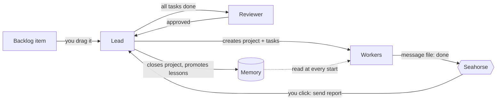

# Files and workflow

Seahorse itself is just a server and a page. **The agents and their memory are created inside your project** when you run Setup, so you won't find them in this repo except in the example.

<table>
<tr><th>This repo (the tool)</th><th>Your project, after Setup</th></tr>
<tr><td valign="top">

```text
seahorse/
├── server.mjs       the local server
├── public/          the board (one HTML page)
├── lib/             generators and feedback logic
├── kit/             starter files copied into
│   ├── agents/        your project by Setup
│   ├── commands/
│   └── orchestrator/
└── examples/
    └── acme-billing/  a finished example
```

</td><td valign="top">

```text
your-app/
├── .claude/commands/        the agents
│   ├── acme-lead-agent.md
│   ├── acme-api-agent.md
│   └── …
├── orchestrator.json        project list
├── backlog.json             bugs, ideas, tasks
├── orchestrator/
│   ├── memory/              the team's memory
│   │   ├── core.md            rules + permissions
│   │   ├── domain_context.md  modules, conventions
│   │   ├── lessons.json       mistakes learned
│   │   └── patterns.json      code style
│   ├── projects/<id>/       one folder per project
│   ├── research/            review reports
│   ├── schemas/  templates/
└── .seahorse/               Seahorse's own state
```

</td></tr>
</table>

| File | Written by | What it holds |
|---|---|---|
| `.claude/commands/*.md` | Setup | One file per agent, run as a slash command such as `/acme-lead-agent` |
| `orchestrator/memory/core.md` | Setup, then **only you** | The rules every agent follows and the permission matrix |
| `orchestrator/memory/domain_context.md` | Setup, then you | What discovery learned: modules, conventions, constraints, commands |
| `orchestrator/memory/lessons.json` | The lead | Mistakes worth never repeating, with the fix |
| `orchestrator/memory/patterns.json` | The archaeologist | Code style rules |
| `orchestrator.json`, `backlog.json` | The lead | Every project and the backlog |
| `orchestrator/projects/<id>/` | The lead and the agents | Status, spec, tasks, an event log, and one message file per agent |
| `orchestrator/research/review-<id>.md` | The reviewer | Review reports |
| `.seahorse/` | Seahorse | Onboarding proposal, feedback you logged, reminders, skill assignments |

Setup never overwrites a file that exists, and it leaves `orchestrator/projects/` empty: the lead creates a folder when it starts a project.

## How it works

One rule holds the team together: **if it isn't in a JSON file, it didn't happen.** Agents never talk to each other. Each appends to its own message file, and the lead reads those files and decides what happens next. Seahorse watches the files and shows you the next step.



| Agent | Job | Instructed write scope |
|---|---|---|
| Lead | Turns ideas and bugs into projects and tasks, routes work, promotes lessons | Project state, backlog, `lessons.json` |
| Strategist | Scopes a feature idea into a handoff block | Nothing |
| Workers | Build their tasks, one agent per area (for example `api_agent`, `web_agent`) | Their code paths and their own message file |
| Reviewer | Checks the work against the task and the project's rules | Review reports and its message file |
| Archaeologist | Keeps `CLAUDE.md` and `ARCHITECTURE.md` files true to the code | Docs and `patterns.json` |

A project moves through `task_defined → research → spec_ready → implementation → review → done`. The agent instructions give the lead ownership of phase changes and require an approved review before closing a project. Seahorse displays these files; it does not enforce this protocol at runtime.


[Back to the README](../README.md)
